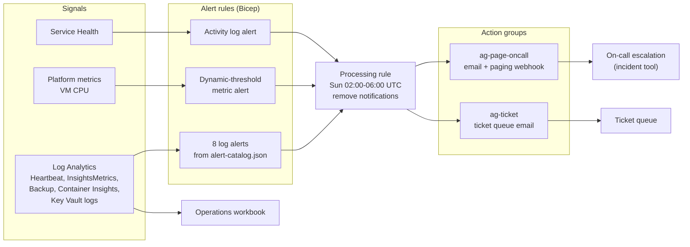

# Cloud Observability and Incident Response

An Azure Monitor alerting baseline defined as data and deployed with Bicep: severity-based routing, runbook-linked alerts, noise controls, and an operations workbook. It comes with the incident process around it (severity model, escalation, recovery verification, post-incident review) and a fully worked simulated incident that traces a user-facing outage down through four layers of symptoms to its root cause.

| | |
|---|---|
| Project type | Independently built lab. The alerting pipeline concepts reflect professional MSP operations; no employer or client configuration is included. |
| Local validation | Bicep build and lint clean; 77 catalog, workbook, and template tests pass ([evidence](docs/validation/README.md)) |
| Cloud validation | Not yet deployed. Queries haven't been run against a populated workspace. |
| Incident | INC-SIM-0001 is simulated and labeled as such |

## Problem

Monitoring usually fails in two directions at once. Too many alerts, so people stop reading them. And no alert for the thing that actually breaks, or an alert at the wrong severity, which in practice is the same as no alert. Both come from treating alerts as one-off portal configuration instead of designed, reviewed, tested artifacts with an owner and a runbook.

## What's in the repository

| Component | Description |
|---|---|
| [`alerts/alert-catalog.json`](alerts/alert-catalog.json) | 8 log alerts as data: query, threshold, window, dimensions, severity, route, runbook |
| [`infrastructure/main.bicep`](infrastructure/main.bicep) | Action groups (page, ticket), the catalog's log alerts, a dynamic-threshold CPU alert across every VM, a Service Health alert, a maintenance-window suppression rule, and the workbook |
| [`runbooks/`](runbooks/) | One runbook per alert: meaning, first 5 minutes, common causes, resolution, escalation |
| [`dashboards/`](dashboards/) | Operations workbook generated from [`scripts/build_workbook.py`](scripts/build_workbook.py) |
| [`docs/alert-design.md`](docs/alert-design.md) | Severity matrix, routing, threshold design, noise reduction, escalation, third-party integration pattern |
| [`docs/incident-response.md`](docs/incident-response.md) | Lifecycle, roles, severity changes, recovery verification, communication template |
| [`incidents/INC-SIM-0001`](incidents/INC-SIM-0001/incident-report.md) | Simulated incident with timeline, symptom-vs-cause analysis, detection review, and actions |
| [`templates/post-incident-review.md`](templates/post-incident-review.md) | Blameless review template |
| [`reporting/backup-daily-report`](reporting/backup-daily-report/README.md) | Logic App that emails an executive Azure Backup health report daily (managed identity, Resource Graph) |

## Architecture



## Alert catalog

| Alert | Sev | Route | Signal |
|---|---|---|---|
| `vm-heartbeat-missing` | 1 | page | Agent heartbeat gap above 10 minutes |
| `disk-free-critical` | 1 | page | Disk below 5% free |
| `sql-log-backup-chain-stalled` | 1 | page | No successful SQL log backup in 60 min (added by INC-SIM-0001) |
| `aks-node-not-ready` | 1 | page | Node not Ready for 2 consecutive checks |
| `disk-free-low` | 2 | ticket | Disk below 10% free for 2 consecutive checks |
| `backup-job-failed` | 2 | ticket | Backup job failed (manual resolve, 6 h mute) |
| `aks-container-restarts` | 3 | ticket | More than 3 restarts in 30 min |
| `keyvault-access-denied-spike` | 3 | ticket | More than 20 403s from one caller in 15 min |
| `vm-cpu-anomaly` (metric) | 3 | ticket | CPU above learned baseline, 3 of 4 periods |
| `service-health-incident` (activity) | n/a | page | Azure-declared incident |

## Engineering decisions and tradeoffs

| Decision | Reason | Tradeoff |
|---|---|---|
| Alerts as data plus tests | Rules (runbook exists, severity matches route, dimensions exist in the query) are enforced on every change | New alert types (metric, activity) still need Bicep changes |
| Two thresholds per capacity signal | Business-hours action at 10%, page at 5% | Two alerts to maintain |
| Leading-indicator alert for log backups | Fires hours before the disk fills ([INC-SIM-0001](incidents/INC-SIM-0001/incident-report.md)) | Specific to SQL workload backup |
| Suppress notifications, not alerts, in maintenance | History preserved; no 3 a.m. pages for planned restarts | A real failure during the window isn't paged. The window is short and staffed. |
| Dynamic thresholds for CPU | Adapts per VM | Needs about 3 days of history; less predictable than a fixed number |
| Page route also tickets | Every page leaves a record | Duplicate notification for the on-call engineer |

What happens when monitoring itself fails: an alert with no data is silent. INC-SIM-0001 shows this (the disk alert had no data for one VM), and the open actions add policy-based agent onboarding and a coverage alert.

## Deployment

```bash
az deployment group create -g rg-monitoring \
  --template-file infrastructure/main.bicep \
  --parameters infrastructure/lab.bicepparam \
  --parameters pagingWebhookUrl="$PAGING_WEBHOOK_URL"
```

Prerequisites: an existing Log Analytics workspace (for example from [azure-enterprise-landing-zone](https://github.com/RaeRucker/azure-enterprise-landing-zone)), with VM insights, Container Insights, Azure Backup diagnostic settings (resource-specific tables), and Key Vault diagnostics sending data to it. *Monitoring Contributor* on the resource group, and on the subscription for the metric and activity alerts.

## Validation

```bash
python scripts/build_workbook.py     # regenerate the workbook
pytest -v tests/                     # 77 tests
```

After deployment, verify end to end: trigger each action group with Test action group in the portal, stop a lab VM to fire `vm-heartbeat-missing`, and confirm the notification includes the runbook link.

## Security

- The paging webhook URL is a `@secure()` parameter, so it isn't stored in deployment history. Supply it from a pipeline secret.
- Alert notifications include query results. Avoid adding columns with secrets or personal data to alert queries.
- Key Vault 403 spikes are treated as possible probing, not only misconfiguration ([runbook](runbooks/keyvault-access-denied.md)).

## Cost considerations

Log alert rules are billed per rule per evaluation frequency (more frequent evaluation costs more), and per time series when split by dimensions. Metric alerts are billed per monitored time series. Action group emails are free up to a quota; SMS and voice are billed per message. The largest cost is usually the Log Analytics ingestion these alerts depend on, not the alerts themselves. Remove everything with `az group delete` on the monitoring resource group.

## Limitations and known gaps

- Not deployed, so alert behavior against real data is unverified.
- Heartbeat alerts auto-resolve after an hour of silence (documented in the [runbook](runbooks/vm-heartbeat-missing.md)).
- No application-level (request rate, error rate, latency) alerts. Those need Application Insights or Managed Prometheus.
- The incident is simulated. It demonstrates reasoning, not response under real pressure.

## Future improvements

1. Deploy against the landing zone workspace and capture a real alert firing and resolving.
2. Add SLO-based burn-rate alerts for an application endpoint.
3. Implement open INC-SIM-0001 actions 2 and 3 (policy-assigned VM insights, a coverage alert).
4. Add an Azure Function or Logic App that writes alert-to-acknowledgement times to the workspace for SLA reporting.
