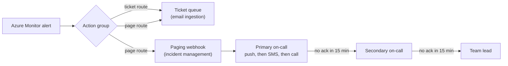

# Alert design

## Principles

1. Every alert needs an action. If nobody would do anything when it fires, it's a dashboard panel, not an alert.
2. Page on symptoms, ticket on causes. Page when users are, or soon will be, affected (host down, disk nearly full, log chain stalled). Use tickets for conditions that need attention within a business day.
3. Every alert links to a runbook. The runbook path is part of the alert definition (in the description, tags, and custom properties), so it appears in the notification. `tests/test_alert_catalog.py` fails if a runbook file is missing.
4. One definition, one place. Log alerts are data in [`alerts/alert-catalog.json`](../alerts/alert-catalog.json). Bicep deploys them, and tests check them against the rules on this page.

## Severity and routing

| Severity | Meaning | Route | Response target | Examples in this repo |
|---|---|---|---|---|
| Sev 0 | Critical service down, no workaround | page | Immediate, 24x7 | Declared by the incident commander, never auto-assigned |
| Sev 1 | Outage imminent or one component down | page (+ ticket) | 15 minutes, 24x7 | Heartbeat lost, disk below 5%, log backups stalled, AKS node NotReady |
| Sev 2 | Degraded or at risk | ticket | Same business day | Disk below 10%, backup job failed |
| Sev 3 | Needs investigation | ticket | Next business day | Container restarts, CPU anomaly, Key Vault 403 spike |
| Sev 4 | Informational | none | n/a | Dashboard only |

The catalog tests enforce the mapping: Sev 0-1 must route to `page`, Sev 2-3 to `ticket`.

## Threshold design

| Decision | Applied here | Why |
|---|---|---|
| Two tiers for the same signal | Disk at 10% (ticket) and 5% (page) | The first gives time to act in business hours. The second means act now. |
| Require consecutive failures | `disk-free-low`: 2 of 2 periods; AKS node: 2 of 2; CPU: 3 of 4 | A single spike or a node rebooting for an update shouldn't wake anyone |
| Use minimum, not average, for capacity | Disk uses `min(Val)` | Averaging over 15 minutes hides a volume that briefly hit zero |
| Dynamic thresholds for "normal varies" metrics | CPU | A static 80% is noisy on batch servers and blind on idle ones |
| Leading indicators over lagging ones | `sql-log-backup-chain-stalled` | Fires hours before `disk-free-critical` for the same failure ([INC-SIM-0001](../incidents/INC-SIM-0001/incident-report.md)) |
| Auto-resolve when the condition clears | All except `backup-job-failed` | A failed backup isn't "fixed" when the next evaluation is quiet. It needs a successful job, so it's closed manually. Its notifications are muted for 6 hours instead. |
| Split by dimension | Computer, Disk, BackupItem, Namespace | One alert per affected thing, so the alert names what's broken |

## Noise reduction

| Technique | Where | Effect |
|---|---|---|
| Maintenance-window suppression | Alert processing rule `apr-maintenance-window` (Sunday 02:00-06:00 UTC, matching patch and AKS upgrade windows) | Expected restarts don't notify. Alerts still record, so the history isn't lost. |
| Mute after firing | `backup-job-failed`: `muteActionsDuration: PT6H` | A failing nightly job doesn't re-notify every 15 minutes |
| Dimension grouping | All log alerts | Ten failed disks produce ten specific alerts instead of one vague alert that hides the scope |
| Severity discipline | Catalog tests | Only Sev 0-1 can page |
| Regular review | Monthly: alerts that fired with no action taken are retuned or deleted | Keeps the catalog honest |

The workbook panels show the same queries without thresholds, so engineers can see a trend before it becomes an alert.

## Escalation path

Escalation timing lives in the incident-management tool, not in Azure. Azure's job is to deliver the right severity, with the runbook link, to the right route.

## Third-party monitoring integration (concept)

Many organizations run a third-party platform (for example LogicMonitor) alongside Azure Monitor. A common pattern, shown here in sanitized form:

| Stage | Responsibility |
|---|---|
| Collector or agent alert | Detects the condition and assigns an alert ID |
| ITSM integration | Creates a ticket. The subject convention includes the ticket number, the client or service code, and the alert title, so tickets and alerts can be correlated. |
| Paging integration | Critical alerts page on-call with escalating notifications |
| Engineer acknowledgement | Stops escalation; the ticket records the response time for SLA reporting |

The same severity-to-route mapping applies to both platforms, so an engineer gets the same urgency for the same failure regardless of which tool detected it.
