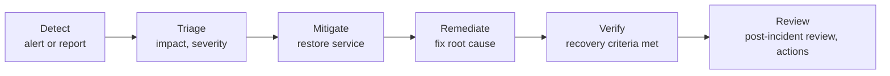

# Incident response process

## Lifecycle

| Phase | Goal | Done when |
|---|---|---|
| Detect | Know something is wrong | Alert acknowledged, or report logged as a ticket |
| Triage | Decide how much it matters | Severity assigned; incident commander named for Sev 0-1 |
| Mitigate | Stop the user impact, even temporarily | Users unaffected (workaround, failover, capacity increase) |
| Remediate | Remove the cause | The thing that started the chain is fixed |
| Verify | Prove recovery | The criteria below are met, not just "the alert cleared" |
| Review | Prevent recurrence | Post-incident review published within 5 business days; actions have owners |

## Roles (Sev 0-1)

| Role | Responsibility |
|---|---|
| Incident commander | Owns decisions and severity; keeps the team on one plan; doesn't debug |
| Technical lead | Runs the investigation and proposes mitigations |
| Communications | Updates stakeholders on a fixed cadence (every 30 min for Sev 1) |
| Scribe | Keeps the timeline; this becomes the review's timeline |

In a small team, one person may hold several roles, but the commander role is never combined with hands-on debugging.

## Severity changes

Severity reflects current impact and risk, not how hard the problem is. Raise it as soon as the impact grows. Lower it once mitigation holds, and keep the incident open until remediation and verification are done.

## Recovery verification checklist

- [ ] User-facing check passes (synthetic transaction or a real user confirms)
- [ ] The alert that detected the issue has cleared, *and* the underlying metric is back within normal range (not just under the threshold)
- [ ] Dependent jobs caught up (backups, queues, replication)
- [ ] No new errors in application and platform logs for 30 minutes
- [ ] Any temporary mitigation is recorded, with a follow-up to remove or formalize it

## Communication template

> [Sev N] [Service] [Investigating | Mitigated | Resolved]: [one sentence of impact in user terms]. Started [time UTC]. Current status: [what we know and what we're doing]. Next update by [time UTC].

## Post-incident review

Use [`templates/post-incident-review.md`](../templates/post-incident-review.md). Reviews are blameless: the question is which conditions let a reasonable action cause harm, not who made a mistake. [INC-SIM-0001](../incidents/INC-SIM-0001/incident-report.md) is a worked example.
