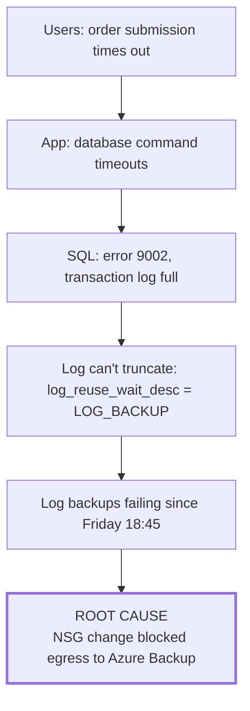

# INC-SIM-0001: Order processing slowdown caused by stalled SQL log backups

> SIMULATED INCIDENT. This scenario was constructed to demonstrate incident handling and diagnostic reasoning. The environment, timestamps, and names are fictional, and no output here was captured from a real system. The failure chain is technically realistic: each link is documented Azure and SQL Server behavior.

| | |
|---|---|
| Severity | Sev 1 (declared 09:41), downgraded to Sev 2 at 10:25 |
| Duration of user impact | 08:55 to 10:20 (85 minutes of degraded order submission) |
| Detection | User reports; no alert fired before impact (see *Detection*) |
| Root cause | An NSG egress change blocked the SQL VM from reaching Azure Backup. Log backups stopped, the transaction log couldn't truncate, and the log volume filled. |
| Status | Resolved; actions tracked below |

## Summary

On Monday, order submission slowed and then failed intermittently for about 85 minutes. The database server's transaction log volume had run out of space, so SQL Server couldn't commit write transactions. The log had been growing since Friday evening, when a network hardening change blocked outbound traffic that SQL log backups depend on. Without successful log backups, SQL Server can't reuse log space. A backup-failure alert did fire Friday night, but at ticket severity, and it wasn't seen until Monday.

## Timeline (all times UTC)

| Time | Event | Source |
|---|---|---|
| Fri 18:30 | Change CHG-SIM-104 applied: NSG rule `DenyInternetOutbound` (priority 4000) added to the data subnet as part of a hardening task. Service-tag exceptions for Azure Backup weren't included. | Change record, Activity Log |
| Fri 18:45 | First SQL log backup failure (network timeout to the backup service) | Vault backup jobs |
| Fri 19:00 | `la-backup-job-failed` fires (Sev 2, ticket), then muted 6 h per item. Ticket created in the queue. | Azure Monitor, ticket system |
| Sat-Sun | Log backups keep failing every 15 minutes. `log_reuse_wait_desc = LOG_BACKUP`. The log file autogrows repeatedly on `L:`. | SQL DMVs (reconstructed) |
| Mon 06:00 | The daily backup report email lists 1 failed item. It's not read before the incident. | Backup report |
| Mon 08:40 | `L:` reaches 4% free. `la-disk-free-critical` doesn't fire: VM insights performance collection wasn't enabled on this VM, so `InsightsMetrics` had no data for it. | Post-incident review |
| Mon 08:55 | Log autogrowth fails. SQL error 9002 (*The transaction log for database 'Orders' is full due to 'LOG_BACKUP'*). Write transactions start failing. | SQL error log |
| Mon 09:20 | Customer service reports that order submission is timing out | Phone, then ticket |
| Mon 09:28 | On-call engineer engaged. Application error log shows database timeouts. | Ticket |
| Mon 09:41 | Incident declared Sev 1. Incident commander assigned. | Incident channel |
| Mon 09:52 | SQL error log shows 9002 and the `LOG_BACKUP` wait. `L:` has 0 MB free. | SQL Server |
| Mon 10:05 | Mitigation: `L:` extended from 64 GB to 128 GB (online) and the volume expanded. Writes resume. | Engineer |
| Mon 10:12 | Root cause found: on-demand log backup fails. Effective security rules on the NIC show `DenyInternetOutbound` matching traffic to the backup service. | Network Watcher |
| Mon 10:18 | Fix: NSG rules added allowing outbound 443 to the `AzureBackup`, `Storage.EastUS2`, and `AzureActiveDirectory` service tags at priority 3900 (above the deny) | Change CHG-SIM-107 (emergency) |
| Mon 10:20 | On-demand log backup succeeds. `log_reuse_wait_desc` returns to `NOTHING`. User impact ends. | Vault, SQL DMVs |
| Mon 10:25 | Downgraded to Sev 2 while the remaining backups and log size are verified | Incident commander |
| Mon 11:40 | Full backup completed. Log space reused. Incident resolved. | Vault |

## Symptom vs cause

The investigation moved through four layers. Each one was a symptom of the one below it:

Stopping at any upper layer would have produced the wrong fix:

| If the team had stopped at | The likely "fix" | Why it would fail |
|---|---|---|
| App timeouts | Restart the application, scale out | The database still can't commit writes |
| Log full | Shrink the log, or switch to SIMPLE recovery | Breaks the log chain (no point-in-time restore) and hides the problem until the next full |
| Disk full | Extend the disk (the mitigation actually used) | Correct as a *mitigation* only. The disk would fill again in about three days. |
| Backups failing | Re-register the VM with the vault | The network path is still blocked |

## Detection: what worked and what didn't

| Signal | Fired? | Why it didn't prevent impact |
|---|---|---|
| `la-backup-job-failed` | Yes, Fri 19:00 | Sev 2, ticket route. Correct by policy, but the queue isn't watched on weekends, and a failed *log* backup is more urgent than a failed nightly VM backup. |
| Daily backup report | Yes, Mon 06:00 | Listed the failure but didn't explain its consequence |
| `la-disk-free-critical` | No | No data: VM insights wasn't enabled on the VM. An alert with no data is silent, not failing. |
| User reports | Yes, Mon 09:20 | Detection by users. 25 minutes after impact began. |

## Contributing factors

1. The hardening change was reviewed for what it blocks, but not tested for which dependencies use outbound traffic.
2. Backup failures for log backups and VM backups shared one severity.
3. Monitoring coverage wasn't verified: the disk alert existed but had no data for this VM.
4. No alert detects "data stopped arriving" for a monitored resource.

## Action items

| # | Action | Type | Owner | Status |
|---|---|---|---|---|
| 1 | Add `la-sql-log-backup-chain-stalled` (Sev 1, page): no successful log backup for 60 min | Detect | Monitoring | Done ([alert catalog](../../alerts/alert-catalog.json)) |
| 2 | Enable VM insights through a policy-assigned data collection rule, so coverage doesn't depend on manual onboarding | Detect | Platform | Open |
| 3 | Add a "no performance data from a VM sending heartbeats" coverage alert | Detect | Monitoring | Open |
| 4 | Add the backup service-tag allowances to the network baseline, so any egress deny ships with them | Prevent | Network | Open |
| 5 | Add "dependencies on outbound traffic" to the NSG change checklist; test backups after network changes | Prevent | Change mgmt | Open |
| 6 | Runbook: never shrink the log or change the recovery model as a fix for 9002 | Respond | DBA | Done ([runbook](../../runbooks/sql-log-backup-chain-stalled.md)) |

## Lessons

- An alert that fires at the wrong severity behaves, in practice, like an alert that didn't fire.
- An alert with no data is silent. Monitoring coverage needs its own check.
- Mitigation (extend the disk) and remediation (fix the egress rule) are different steps. Record both, and don't close the incident after the mitigation.
