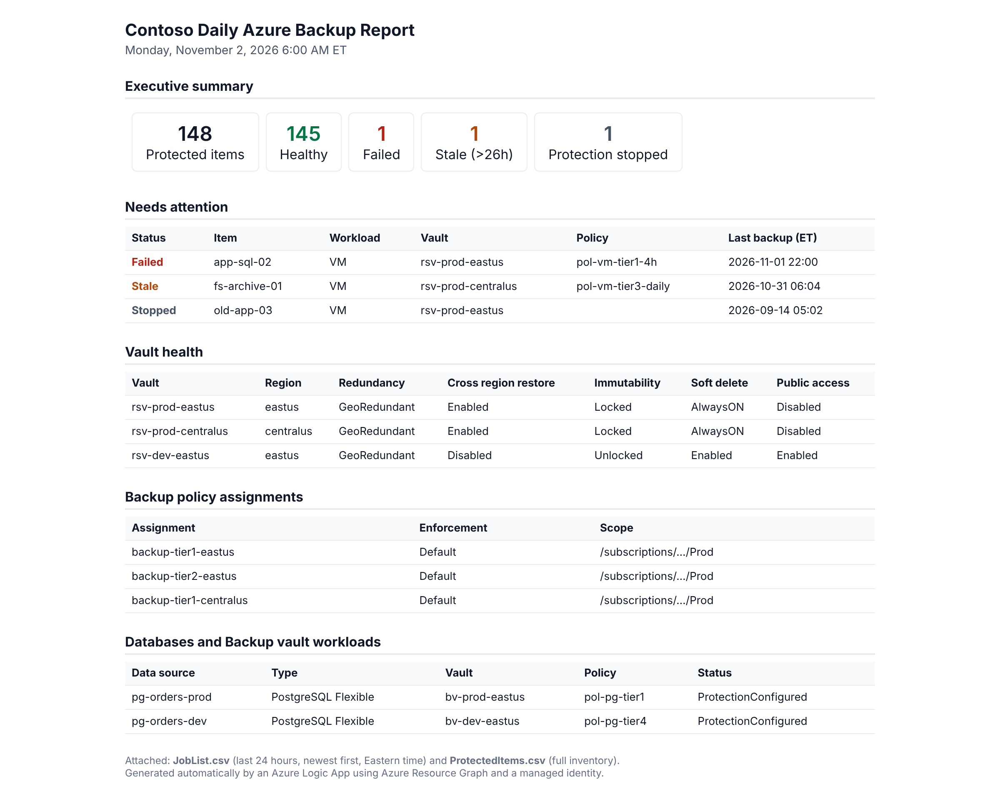

# Azure Backup Reporting: Daily Email Report and Health Queries

An Azure Logic App that emails a formatted Azure Backup health report every morning, plus a library of Resource Graph and Log Analytics queries for dashboards and audits.

There are no stored credentials (it uses a managed identity), no agents, and no servers to maintain. It reads backup data across every subscription you point it at and delivers a report that a CIO can skim in 30 seconds and an engineer can act on.



## Background

A client's CIO asked for a daily view of backup health that didn't require logging in to the portal. The built-in Azure Backup reports weren't what leadership wanted to read, so I rebuilt the report as a Logic App with a custom layout: an executive summary at the top, problems first, and full detail in the CSV attachments. The client's IT lead approved the format, and the report runs every morning at 6 AM Eastern. This repo is the environment-neutral version.

## What's in the report

| Section | Source | Why it matters |
|---|---|---|
| Executive summary: protected / healthy / failed / stale / stopped | Resource Graph | One-glance status for leadership |
| Needs attention: only items that are failing, stale, or stopped | Resource Graph | Engineers see the work first and nothing else |
| Vault health: redundancy, cross-region restore, immutability, soft delete, public access | Resource Graph | Shows the security posture auditors ask about |
| Backup policy assignments | Azure Policy | Shows backup is enforced, not ad hoc |
| Databases and Backup vault workloads (PostgreSQL, Blob, Disks) | Resource Graph | Covers what Recovery Services vaults don't |
| JobList.csv: last 24 h of jobs, newest first, in Eastern time | Resource Graph | Detail for anyone who needs it |
| ProtectedItems.csv: full inventory | Resource Graph | Audit evidence |

If the report itself fails to run, a separate failure alert goes to the ops mailbox, so a missing report never goes unnoticed.

## Architecture

```text
 Recurrence (6:00 AM Eastern)
          │
          ▼
 ┌─────────────────────────── Scope: Build_report ───────────────────────────┐
 │  HTTP → Azure Resource Graph (managed identity, Reader)  × 6 queries       │
 │     summary · protected items · jobs (24h) · vault health ·                │
 │     policy assignments · Backup vault instances                            │
 │          │                                                                 │
 │  Filter (not Healthy) → Select → HTML tables                               │
 │  Select (UTC → Eastern) → CSV tables                                       │
 │  Compose → custom HTML email                                               │
 └───────────────────────────────────────────────────────────────────────────┘
          │ Succeeded                         │ Failed / TimedOut
          ▼                                   ▼
 Send report (Outlook) + 2 CSVs        Send failure alert to ops
```

Why Resource Graph instead of the Recovery Services API? One query covers every vault in every subscription, results come back as clean JSON objects, and it only needs the Reader role.

## Repository layout

```text
Azure-Backup-Reporting/
├── logic-app/
│   └── workflow.json                    # Paste into Logic App code view
├── templates/
│   └── email-report.html                # The email layout (also embedded in workflow.json)
├── queries/
│   ├── resource-graph/
│   │   ├── summary.kql                  # Executive summary counts
│   │   ├── protected-items.kql          # Every protected item + health rating
│   │   ├── backup-jobs-24h.kql          # Recent jobs, newest first
│   │   ├── vault-health.kql             # Redundancy, immutability, soft delete, network
│   │   ├── backup-policy-assignments.kql
│   │   ├── backup-vault-instances.kql   # PostgreSQL / Blob / Disk protection
│   │   └── unprotected-vms.kql          # Coverage gaps
│   └── log-analytics/
│       ├── job-history-30d.kql          # Long-term history (Eastern time)
│       └── success-rate-by-day.kql      # Trend chart for a workbook
└── docs/
    ├── setup-guide.md                   # Step-by-step portal setup + troubleshooting
    └── example-email.png
```

## Quick start

Follow [`docs/setup-guide.md`](docs/setup-guide.md). In short:

1. Create a Consumption Logic App and turn on its system-assigned managed identity.
2. Grant that identity Reader on the subscriptions (or management group) to report on.
3. Paste [`logic-app/workflow.json`](logic-app/workflow.json) into code view, connect Outlook, and set the parameters.
4. Run trigger, then check the run history and the inbox.

## Using the queries on their own

Every query in `queries/resource-graph/` runs as-is in Resource Graph Explorer in the portal. That's handy during an incident ("which backups failed last night?") or an audit ("show me every vault without immutability"). The same queries can be pinned to an Azure Workbook for a live dashboard (see the setup guide).

## Design notes

- Stale = no successful backup in 26 hours. That gives daily policies a 2-hour buffer. Adjust it in `protected-items.kql` and `summary.kql` if you have weekly-only policies.
- Times are converted to Eastern in the Logic App (`convertFromUtc`), not in the query, so the same queries stay reusable for other time zones.
- Resource Graph keeps 14 days of jobs. For longer history, send vault diagnostics to Log Analytics and use the `log-analytics` queries.
- No secrets. The only credential is the Outlook connection, which is owned by the mailbox that sends the report.

## Skills demonstrated

Azure Logic Apps · managed identities and least-privilege RBAC · Azure Resource Graph and KQL · Azure Backup and Backup vaults · Azure Monitor Workbooks · reporting for executive and technical audiences
